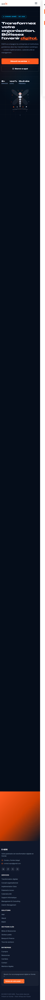
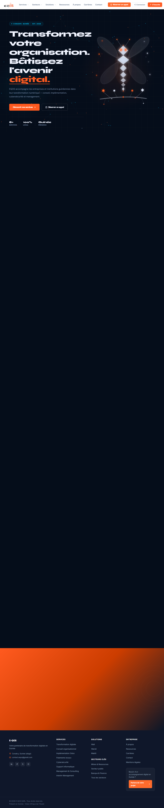
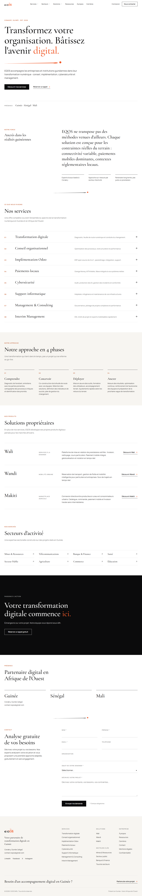
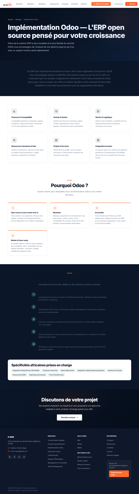
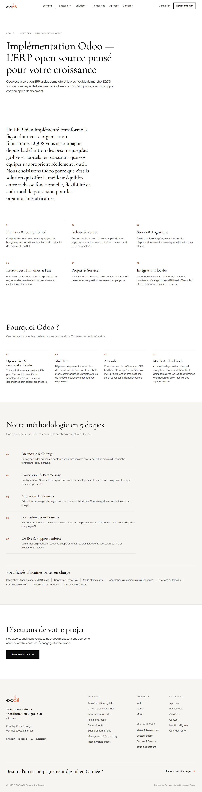
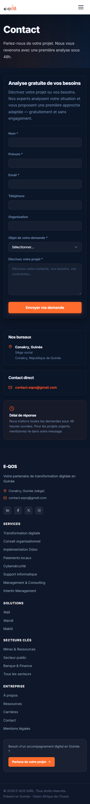
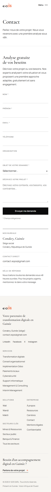

# Refonte premium du site e-qos.com

## Pourquoi

Le site est la vitrine d'E-QOS auprès de clients, d'institutions et de partenaires. Le design actuel (fonds sombres animés, compteurs, carrousel, cartes à ombres) ne reflète pas le positionnement de la société. Cette PR applique une direction éditoriale sobre : serif pour les titres, filets fins, beaucoup de blanc, orange en touches rares. Elle ne change ni la stack, ni les routes, ni les balises meta, et n'invente aucun contenu.

## Ce qui change

- Système de design : tokens, Cormorant Garamond et Manrope auto-hébergées, focus visible, `prefers-reduced-motion`.
- Trait signature tiré du logo, tracé une fois sous le titre du hero.
- Nouvel en-tête (sous-menus accessibles au clavier, menu mobile plein écran) et nouveau pied de page clair.
- Accueil reconstruit à partir des textes existants. Retirés : compteurs, carrousel de témoignages, fond animé, mascotte.
- Formulaire de contact restylé avec validation par champ, envoi inchangé.
- Pages Services, Secteurs, Solutions, Wali, Wandi, Makiti et À propos alignées sur le même système.
- Supabase et la modale d'authentification ne sont plus dans le bundle initial.
- **Réorientation** : le site met en avant la mise en relation et l'intérim dans tous les domaines en Guinée (nouvelle page `/mise-en-relation`, accueil recentré, entrée en tête de navigation). Les services numériques restent accessibles au second plan.

Détail complet, liste exacte des textes modifiés et questions ouvertes : `docs/redesign/REPORT.md`.

## Mesures (Lighthouse mobile, médianes appariées avant/après)

| Page | Perf. | Access. | LCP | CLS | Poids |
|---|---|---|---|---|---|
| `/` | 67 → **91** | 94 → **100** | 4,5 → **2,1 s** | 0,08 → **0** | 363 → **174 Kio** |
| `/contact` | 83 → 86 | 96 → **100** | 3,4 → **2,4 s** | 0 | 241 → 177 Kio |
| `/services/odoo` | 84 → 83 | 94 → **100** | 3,4 → 2,5 s | 0,007 → **0** | 243 → 183 Kio |

axe-core : 0 violation sur 14 contrôles (avant : contraste insuffisant partout). 40 routes sur 40 OK. Build et `tsc` sans avertissement.

Le score de performance des pages internes reste sous 90 à cause du TBT, très variable sur la machine de mesure. À confirmer sur la prévisualisation Netlify.

## Captures

| | Avant | Après |
|---|---|---|
| Accueil 375 px |  |  |
| Accueil 1280 px |  |  |
| Odoo 1280 px |  |  |
| Contact 375 px |  |  |

Toutes les captures (7 pages × 4 largeurs) : `docs/redesign/screenshots/`.

## À valider avant fusion

1. Présence réelle : Guinée seule, ou Guinée, Sénégal et Mali ?
2. Témoignages retirés : sont-ils réels ?
3. « Est. 2026 » face à « 3+ années d'expertise ».
4. Affirmations non sourcées encore visibles (« Plus de 100 organisations… », « des milliers d'utilisateurs »).
5. Logo SVG et version pour fond sombre à fournir.
6. Textes de la nouvelle offre (rédigés, à valider) et cadre légal de l'intérim (REPORT.md, section 9).

## Comment tester

```bash
npm install
npm run build && npm run preview
```

Parcours à vérifier : navigation au clavier dans l'en-tête, menu mobile à 375 px, envoi du formulaire (vide puis rempli), ouverture de la connexion.

🤖 Generated with [Claude Code](https://claude.com/claude-code)
